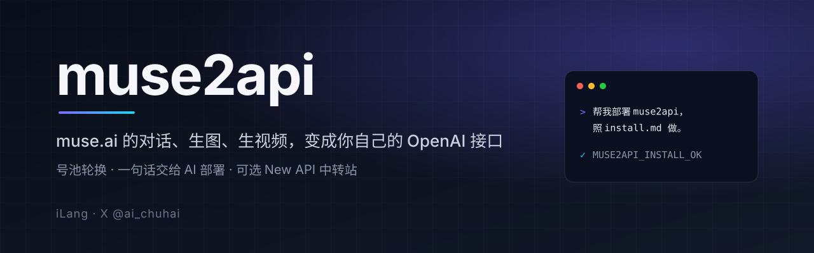

<div align="center">



<br>

<a href="https://x.com/ai_chuhai"></a>


<p>
<a href="#一句话安装">一句话安装</a> ·
<a href="#一步一步">一步一步</a> ·
<a href="#装好以后">装好以后</a> ·
<a href="#中转站new-api">中转站</a> ·
<a href="#常见问题">常见问题</a> ·
<a href="#english">English</a>
</p>

</div>

---

## 这是什么

- 把 **muse.ai 网页端的对话、生图、生视频**变成 **OpenAI 兼容接口**，装在你自己的海外服务器上。
- 多个 muse.ai 号组成**号池**，轮着用，一个号额度用完自动换下一个。
- 不用写代码：把一句话交给你的 AI，它照着工程书装好；你只输一次服务器密码、登录一次 muse.ai。
- 想分给自己人用，可以勾上 **New API 中转站**：每人一个令牌，用量和额度分开管。

## 一句话安装

在 Claude Code、Codex、Cursor、Gemini CLI、DeepSeek Harness、Grok Bot 这类能跑命令的 AI 里贴：

```text
帮我部署 muse2api，照 https://raw.githubusercontent.com/adsorgcn/muse2api/main/install.md 做。
```

国内打不开 raw.githubusercontent.com 的，把地址换成 `https://cdn.jsdelivr.net/gh/adsorgcn/muse2api@main/install.md`。

## 一步一步

| 步骤 | 你做什么 | 这一步要准备的 |
| :--: | --- | --- |
| **0** | 准备好右边这些 | 一台海外 Linux 服务器（Ubuntu 或 Debian，内存 2G 起，有公网 IPv4）和它的 root 密码；一个或几个 muse.ai 账号（登录用邮箱）；一个能跑命令的 AI；要 https 或中转站，再准备一个域名 |
| **1** | 把上面那句话贴给 AI | 无 |
| **2** | 在 AI 弹出的卡片上勾这次装哪些：muse2api 本体、域名加 https、中转站 New API；勾了中转站再选注册（开放 / 只由你建账号）和计价（免费 / 按次定价） | 想好要不要域名、要不要中转站；按次定价就想好对话、生图、视频各收多少美元 |
| **3** | 告诉 AI 服务器 IP | 服务器 IP；SSH 不是 22 端口就连端口一起给 |
| **4** | 输一次 root 密码：AI 在你电脑上就在你自己的终端里输，AI 在云电脑上（比如 Grok Bot）就接管它的电脑输 | root 密码。AI 看不到，也不会问你要 |
| **5** | 勾了域名的：在域名后台加一条 A 记录，指向服务器 IP | 域名管理后台。解析在 Cloudflare 的只开 DNS（灰云），有 AAAA 记录的要指向这台或删掉 |
| **6** | 等它装完，第一次要几分钟 | 无 |
| **7** | 导号：AI 弹出一个干净的 Chrome 窗口，在里面登录 muse.ai，先填邮箱，再填邮件里的验证码 | muse.ai 账号的邮箱。只有这个新窗口算数，导入成功前别关它 |
| **8** | 看 AI 的回报：接口地址、去哪看密钥、号池里几个号；装了中转站就登录 New API 给自己和亲友建令牌 | 无 |

以后要**加号**，新开一个对话贴：

```text
导号，照 https://raw.githubusercontent.com/adsorgcn/muse2api/main/install.md 的 M3 做。
```

想加哪一项（比如后来才有域名、才想开中转站），再贴一遍第 1 步那句话，在卡片上勾上，已装的不会重装。

## 装好以后

| 你要用的 | 在哪 |
| --- | --- |
| 接口地址 | `你的地址/v1`，模型 `muse-spark` 对话、`muse-image` 生图、`muse-video` 生视频；`gpt-4o` 一类常见名字也会自动对上 |
| 密钥 | 在服务器上 `grep ^MUSE2API_KEY= /opt/muse2api/.env` |
| 管理页 | `你的地址/admin?key=你的密钥`，看号池、测号、给号配代理 |
| 中转站（装了的话） | `https://你的域名`，管理员 `root`，密码在服务器上 `grep ^password= /opt/new-api/.admin` |
| 升级 | 在服务器上重跑安装命令，密钥和号池都保留 |

调用示例：

```bash
curl 你的地址/v1/chat/completions \
  -H "Authorization: Bearer 你的密钥" -H "Content-Type: application/json" \
  -d '{"model":"muse-spark","stream":true,"messages":[{"role":"user","content":"你好"}]}'
```

生图、生视频是长任务，用 `/v1/images/tasks`、`/v1/videos` 提交后轮询结果。装了中转站的，把 `你的密钥` 换成 New API 里建的令牌。

## 中转站（New API）

[New API](https://github.com/QuantumNous/new-api) 官方的说法：面向应用、Agent 和团队的自托管 AI 网关，在同一套控制台中管理渠道、访问权限、用量与成本。

- 装在 `/opt/new-api`，跟 muse2api 用同一个域名：`/admin` 和 `/v1/media/` 还是 muse2api，其余交给 New API。安装会把 muse2api 加成它的一个渠道。
- 登录后给自己和亲友建令牌；用户、分组、令牌、额度、用量都用 New API 后台自己的功能管。
- 注册和计价是装的时候在卡片上选的，以后重跑带上 `--relay-register` 或 `--relay-price` 就能改。
- 在网页里改了 root 密码，把服务器上 `/opt/new-api/.admin` 也改了，不然以后重跑更新不了 New API。
- 收款：New API 的说明里写着，开收款、充值、兑换码之前要管理员先确认它的合规条款，收款渠道在它的设置里配。
- 视频经中转站能提交、能查进度，查到的结果里带视频链接，直接下载。New API 自带的取视频接口对 muse2api 不通，需要的话交给你自己的 AI 处理。
- 不想要了：`--no-relay` 停掉它，数据留在 `/opt/new-api`。

## 导号进号池

AI 会替你做（第 7 步）。自己动手的话，在你自己电脑的 Chrome 上二选一：

- **Python 助手**：`scp root@你的IP:/opt/muse2api/tools/get_muse_cookie.py .`，设好环境变量 `MUSE2API_BASE`、`MUSE2API_KEY`，运行 `python get_muse_cookie.py --label 号1`，在弹出的干净窗口里登录。
- **扩展**：`scp -r root@你的IP:/opt/muse2api/extension .`（或下载 `你的地址/admin/extension`），在 `chrome://extensions` 打开开发者模式，加载这个文件夹；登录 muse.ai 后点扩展图标，填地址、密钥、标签，点「读取并导入」。

没有域名时，从 `http://` 地址下载的东西可能在路上被换掉，用 `scp` 更稳。每导一个号，在管理页点一次「测试」。

<details>
<summary><b>不用 AI，自己上服务器装</b></summary>

<br>

Ubuntu 或 Debian，用 root 跑：

```bash
curl -fsSL https://raw.githubusercontent.com/adsorgcn/muse2api/main/install.sh | bash
```

带域名：

```bash
curl -fsSL https://raw.githubusercontent.com/adsorgcn/muse2api/main/install.sh | bash -s -- --domain api.example.com
```

带域名和中转站（注册、计价按你的选择填）：

```bash
curl -fsSL https://raw.githubusercontent.com/adsorgcn/muse2api/main/install.sh | bash -s -- --domain api.example.com --relay new-api --relay-register closed --relay-price free
```

- 重跑同一行就是升级，密钥和号池都保留，旧镜像会清掉。
- 带域名时，先在 IP 上装好，再装 nginx、签 Let's Encrypt 证书（不填邮箱），证书签下来才切到 https。
- 80/443 被宝塔、1Panel 这类面板占着时，最后一行是 `MUSE2API_INSTALL_PENDING_PROXY`，照提示在面板里反代到 `http://127.0.0.1:18610` 再跑一次。被 Docker 容器或别的程序占着时，脚本在改动任何东西之前就停下。
- 计价：`--relay-price chat=0.01,image=0.05,video=0.5` 表示每次多少美元；`free` 表示三个都是 0。
- 其他选项：`--no-domain` 换回 IP、`--no-relay` 停掉中转站、`--ip` 手动给公网 IPv4、`--ref` 指定版本、`--dir` 换安装目录、`--force` 跳过内存和磁盘检查。
- 最后一行是 `MUSE2API_INSTALL_OK`、`MUSE2API_INSTALL_PENDING_PROXY` 或 `[muse2api] ERROR:` 三种之一。

</details>

## 常见问题

<details>
<summary><b>证书签不下来</b></summary>

<br>

服务照旧在 `http://IP:18610` 能用，脚本会把 certbot 的原因打出来。最常见的是服务商安全组没放行 80 和 443（Oracle Cloud 的镜像还会在 iptables 里挡掉），放行后重跑同一行。

</details>

<details>
<summary><b>外面连不上 18610</b></summary>

<br>

没域名时 18610 由 Docker 发布，ufw 管不到它。连不上多半是服务商安全组没放行，在服务商面板里放行 TCP 18610。

</details>

<details>
<summary><b>号失效了</b></summary>

<br>

先在管理页点「测试」，不行就再导一次。返回 403 不一定是登录过期，也可能是服务器所在地区的问题，先在 muse.ai 官网确认这个号能用。

</details>

<details>
<summary><b>换密钥</b></summary>

<br>

改服务器上 `/opt/muse2api/.env` 里 `MUSE2API_KEY` 那一行，重跑安装命令，再在管理页的密钥框里填新密钥保存（浏览器会记着旧的）。别用管理页上的「重新生成」，它只撑到容器下一次重启。

</details>

<details>
<summary><b>脚本会不会动我服务器的其他东西</b></summary>

<br>

不碰 sshd、root 登录、密码、钥匙和防火墙规则，不跑 `apt upgrade`。新装 Docker 时 Docker 会加它自己的 iptables 规则。`.env` 里已有的密钥原样保留（带引号、`export` 写法、自定义格式都认），只有上游示例里那个公开的占位密钥 `m2a_your_secret_admin_key_here` 会被换掉，旧 `.env` 备份在旁边。自己手搭、用自己 https 前端的实例，重跑时脚本不接管你的前端。

</details>

## 要求与实测

- 服务器：Ubuntu 或 Debian，有公网 IPv4，内存至少 900 MiB 且内存加 swap 至少 1700 MiB，盘剩 5G 起，能打开 muse.ai。
- 2026-11-23 在一台已装 Docker 的 Ubuntu 24.04 x86_64 上实测：全新安装、原地升级（第二次 3 秒）、占位密钥替换、自定义密钥保留、防并发、域名解析不对或 AAAA 指错时不动手、80 被 Docker 容器占着时不动手、证书签不下来时不切换、签下来后切到 https、切回 IP。工程书里的原样命令和验收在那台机器上跑通；上一版工程书由 Grok Bot 整本跑通。
- 没测过：没装 Docker 的机器（会从 Docker 官方源装）、Debian、arm64、面板占着 80/443 的机器、只有 IPv6 的机器、自动更新正占着 apt 锁的新机器（脚本会等最多 10 分钟）。

## 这个仓库

fork 自 MUSE2API（MIT，原作者 MUSE2API Authors）。原项目的代码一行没改，本仓库只加了 `install.sh`、`install.md` 和给 AI 读的说明（`AGENTS.md`、`CLAUDE.md`、`GEMINI.md`）。上游出新版，先在测试机上跑通再同步进来。

## English

muse2api serves the chat, image and video generation of the muse.ai web app as an OpenAI-compatible API on your own server, with a pool of your own muse.ai accounts.

- Ask your agent: `Deploy muse2api for me by following https://raw.githubusercontent.com/adsorgcn/muse2api/main/install.md`. It shows a choice card (muse2api, a domain with https, the New API relay station), asks for your server IP, has you type the root password yourself, and opens a clean Chrome window for you to log in to muse.ai.
- Or run as root on Ubuntu/Debian with a public IPv4: `curl -fsSL https://raw.githubusercontent.com/adsorgcn/muse2api/main/install.sh | bash`. Add `-s -- --domain your.domain` for https: the service is installed on plain IP first and switched only after nginx and the certificate work. Re-run to upgrade; your key and accounts are kept. It never changes sshd, logins or firewall rules (a fresh Docker install adds Docker's own iptables rules, and without a domain port 18610 is published past ufw).
- Optional relay station: `--relay new-api --relay-register open|closed --relay-price free|chat=X,image=Y,video=Z` puts [New API](https://github.com/QuantumNous/new-api) on the same domain and adds muse2api as its channel; `--no-relay` stops it.
- Import accounts from your own Chrome with `tools/get_muse_cookie.py` or the `extension/` folder (fetch both with `scp` from `/opt/muse2api`).

Forked from MUSE2API (MIT, MUSE2API Authors); upstream code is unchanged.

---

<div align="center">

**觉得有用，关注作者 X [@ai_chuhai](https://x.com/ai_chuhai)，新的工程书会在那里发。**

出品 [iLang](https://ilang.ai) · 更多工程书 [dsh.ilang.guide](https://dsh.ilang.guide/)

</div>
